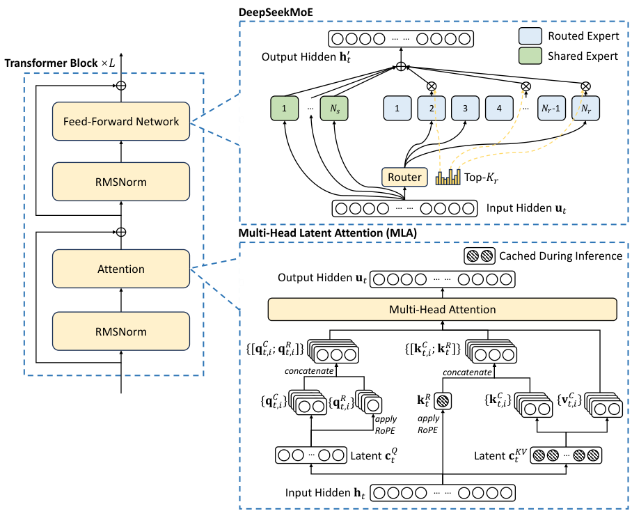

<!-- index.html 的正文副本，供手动编辑；目前修改此文件不会自动更新 HTML。
     Header 仍为 Template + Contents；页面结构要求见 TEMPLATE.md。
     cite 和参考文献锚点保留少量 HTML；公式使用 LaTeX 表示。 -->

# DeepSeek-V3 Technical Report

原报告：DeepSeek-AI　版本：2025-02-18 / arXiv v2　[阅读原文 ↗](https://arxiv.org/pdf/2412.19437v2)

这是一份精简的排版参考：保留少量原文短引，搭配摘要、数据和原报告图片，展示一份静态技术文档的常见格式。中文说明为摘要改写；代码为排版示例。

## 1. 模型概览

DeepSeek-V3 是一个 **Mixture-of-Experts（MoE）** 模型，总参数量为 671B，每个 token 激活 37B 参数。报告描述了模型架构、训练基础设施和训练后对齐流程。<sup>[[1]](#ref-1)</sup>

> 671B total parameters with 37B activated for each token.

### 核心要点

- **注意力：** 使用 MLA 减少推理中的 KV cache。
- **专家路由：** 采用不依赖辅助损失的负载均衡策略。
- **训练目标：** 引入多 token 预测。

以上要点依据原报告摘要与第 2 节整理，用于展示正文、强调、无序列表和文献标记。

## 2. 架构与图示

### 2.1 Multi-Head Latent Attention

MLA 对注意力的 key 和 value 进行低秩联合压缩，推理时缓存压缩表示。下式展示该过程的第一步。<sup>[[1]](#ref-1)</sup>

$$
c_t^{KV} = W^{DKV}h_t
$$



**图 1.** DeepSeek-V3 的基本架构。图片裁自原报告第 7 页 Figure 2；仅裁去页边、图注和正文，未改动图内内容。[查看来源 ↗](https://arxiv.org/pdf/2412.19437v2#page=7)

### 2.2 阅读顺序

1. 先看左侧 Transformer 模块中的 Attention 与 Feed-Forward Network。
2. 再看右上专家模块中的共享专家、路由专家与 router。
3. 最后对照右下 MLA 图，识别推理时需要缓存的表示。

## 3. 训练与表格

训练语料规模为 14.8T tokens。报告按预训练、上下文扩展和训练后对齐三个阶段列出了 H800 GPU 使用量。<sup>[[1]](#ref-1)</sup>

表 1. 训练成本数据，摘录自原报告第 5 页 Table 1。

| 阶段       | H800 GPU 小时 | 估算费用 / USD |
| ---------- | ------------- | -------------- |
| 预训练     | 2,664,000     | $5,328,000     |
| 上下文扩展 | 119,000       | $238,000       |
| 训练后对齐 | 5,000         | $10,000        |
| 合计       | 2,788,000     | $5,576,000     |

**统计口径。** 费用按每 H800 GPU 小时 2 美元估算，仅涵盖正式训练，不包括先前研究和消融实验。[来源 ↗](https://arxiv.org/pdf/2412.19437v2#page=5)

## 4. 代码与引用

用 `37 / 671` 展示行内代码；下面的 Python 仅演示参数比例计算，**不是报告中的官方实现**。

```python
# Illustrative calculation, not model implementation.
def activation_ratio(total, active):
    return active / total

model = {"total": 671, "active": 37}
ratio = activation_ratio(model["total"], model["active"])
print(f"Active parameter ratio: {ratio:.2%}")
```

输出约为 `5.51%`；它是参数比例，不代表计算量、吞吐或延迟的同比变化。

## 参考文献

1. <span id="ref-1"></span>DeepSeek-AI. <cite>DeepSeek-V3 Technical Report</cite>. arXiv:2412.19437v2, 2025. [摘要](https://arxiv.org/abs/2412.19437) · [PDF](https://arxiv.org/pdf/2412.19437v2).

